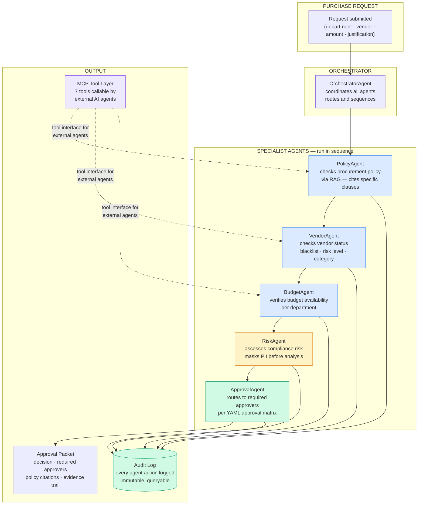
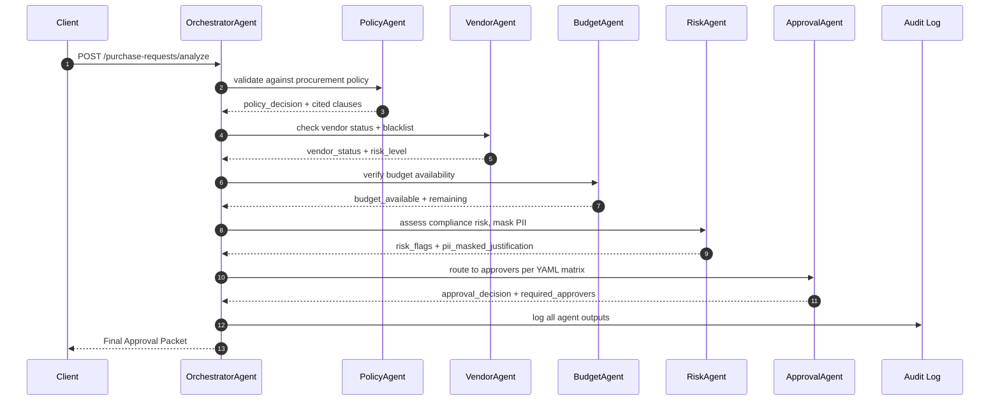
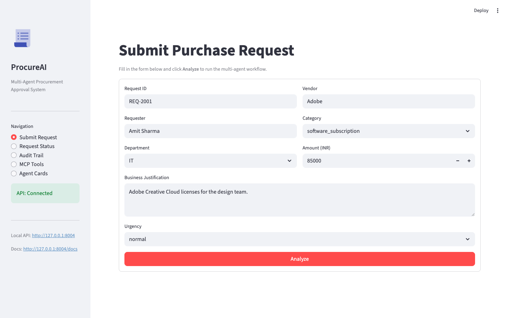
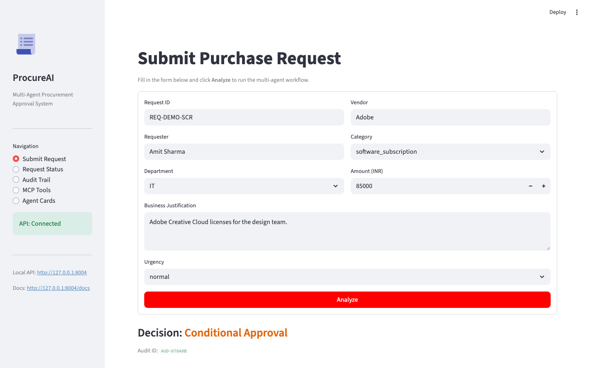
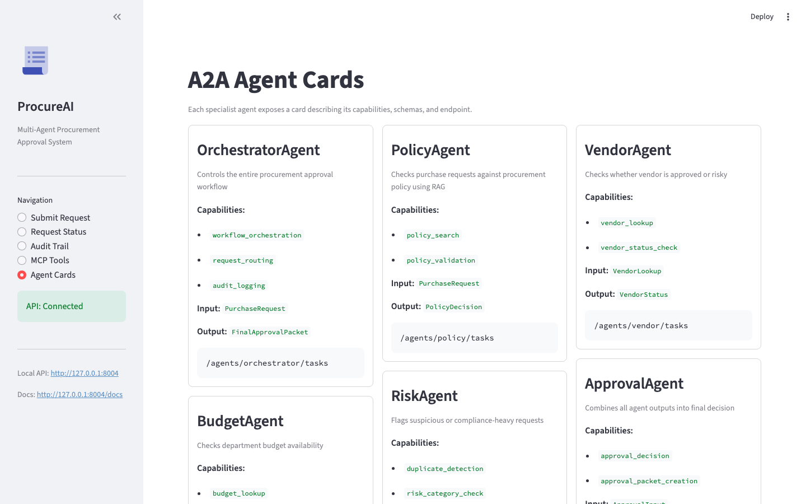
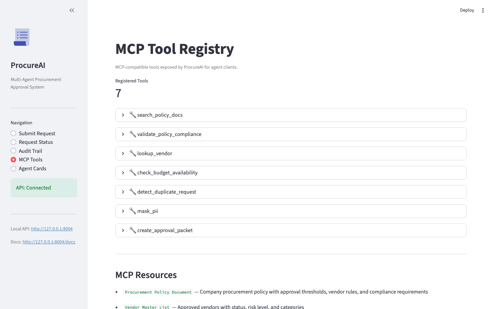

# ProcureAI

> Five-specialist-agent procurement approval system — policy-grounded decisions, MCP-compatible tool layer, A2A agent coordination, and complete audit trail.


---

## The Problem

Purchase requests at most organisations are validated by whoever happens to be reviewing that day. Policy checks depend on institutional memory, not the actual policy document. Budget availability is confirmed by emailing finance. Vendor risk is assumed. The result is approvals that should have been rejected, rejections without documented reasoning, and audit responses that amount to "someone reviewed it."

When a regulator or auditor asks why a $200,000 purchase was approved, the answer should be a structured evidence packet — not an email thread.

---

## What It Does

- **Coordinates five independent specialist agents in sequence** — Policy, Vendor, Budget, Risk, and Approval agents each validate one domain with typed inputs and structured outputs; no monolithic approval logic, no single point of failure
- **Grounds every decision in the actual policy document** — the Policy Agent retrieves the exact clause from indexed procurement policy documents; decisions cite their source, not generic rules
- **Exposes all capabilities as MCP-compatible tools** — any external AI agent, copilot, or orchestration system can call individual checks (vendor lookup, budget validation, policy search) without going through the full pipeline

---

## Agent Architecture



---

## Agent Coordination — Sequence



---

## Screenshots

**Purchase Request Submission** — vendor, department, amount, and justification entered through the dashboard



**Workflow Decision** — five agents run automatically; decision returned with audit ID, required approvers, and evidence



**A2A Agent Cards** — each specialist agent self-describes its capabilities, input/output schemas, and endpoint



**MCP Tool Registry** — seven procurement capabilities exposed as MCP-compatible tools, callable by any external AI agent



---

## MCP Integration

ProcureAI exposes procurement capabilities as MCP-compatible tools. Any external AI agent — Claude, GPT, an AI copilot, another orchestration system — can call individual capabilities directly without going through the full five-agent pipeline. This makes ProcureAI composable into larger AI workflows.

| MCP Tool | What It Does |
|----------|-------------|
| `search_policy_docs` | Search procurement policy documents by keyword or concept |
| `validate_policy_compliance` | Validate a purchase request against configured policy rules |
| `lookup_vendor` | Get vendor status, risk level, and blacklist flag by name |
| `check_budget_availability` | Verify department budget availability for a given amount |
| `detect_duplicate_request` | Detect if a similar request has already been submitted |
| `mask_pii` | Scrub personally identifiable information from justification text |
| `create_approval_packet` | Produce a complete structured approval output |

**MCP Resources available to agents:** procurement policy document, vendor master list, department budgets, approval matrix, sample requests.

**MCP Prompt Templates:** policy compliance check, vendor risk review, approval summary.

---

## A2A Agent Cards

Each specialist agent publishes an A2A-style agent card: a structured descriptor of its name, description, capabilities, input/output schemas, and endpoint. This enables external orchestrators and AI systems to discover and invoke agents without prior knowledge of the system's internals.

| Agent | Capabilities Exposed |
|-------|---------------------|
| OrchestratorAgent | `workflow_orchestration`, `request_routing`, `audit_logging` |
| PolicyAgent | `policy_search`, `policy_validation` |
| VendorAgent | `vendor_lookup`, `vendor_status_check` |
| BudgetAgent | `budget_lookup` |
| RiskAgent | `duplicate_detection`, `risk_category_check` |
| ApprovalAgent | `approval_decision`, `approval_packet_creation` |

Agent cards are available at `/agents/{agent_name}/card`. Tasks can be sent directly to individual agents at `/agents/{agent_name}/tasks`.

---

## Agent Responsibilities

| Agent | What It Validates | Rejection Trigger |
|-------|------------------|-------------------|
| **PolicyAgent** | Is this purchase allowed under procurement policy? Which clause? | Policy explicitly prohibits the category or vendor type |
| **VendorAgent** | Is this vendor approved? Are they blacklisted? What risk level? | Vendor is on the blacklist or flagged as high risk |
| **BudgetAgent** | Does the department have available budget for this amount? | Requested amount exceeds remaining department budget |
| **RiskAgent** | Are there compliance flags? Is PII present in the justification? | High-severity compliance flags detected |
| **ApprovalAgent** | Who must approve based on amount, category, and risk? | Produces required approver list and final decision |

---

## Decision Scenarios

| Scenario | What Happens |
|----------|-------------|
| Standard request, approved vendor, within budget | **Conditional Approval** — required approvers listed, evidence packet generated |
| Blacklisted vendor | **Rejected** — VendorAgent blocks; PolicyAgent and BudgetAgent still run for full evidence |
| Budget exceeded | **Rejected** — BudgetAgent blocks; all prior agent outputs logged |
| Policy violation | **Rejected** — PolicyAgent cites the specific policy clause; full audit trail |

---

## Key Capabilities

| Capability | Detail |
|------------|--------|
| **Five specialist agents** | Independent agents with typed I/O — each replaceable without touching the others |
| **Policy-grounded decisions** | PolicyAgent indexes procurement policy documents; decisions cite specific clauses |
| **YAML approval matrix** | Approval requirements configured in YAML — amount thresholds, categories, required approvers |
| **MCP tool layer** | 7 tools callable by external AI systems — composable into larger agent workflows |
| **A2A agent cards** | Each agent self-describes for inter-agent discovery and direct task invocation |
| **PII masking** | Justification text scrubbed before risk analysis — safe for external processing |
| **Vendor blacklist** | Blacklisted vendors automatically rejected — no manual lookup |
| **Duplicate detection** | Flags requests that have already been submitted |
| **Complete audit trail** | Every agent output logged with timestamps — full decision provenance |
| **Rule-based default** | Runs without an LLM API key — switch to OpenAI or Azure OpenAI via environment variable |
| **Docker Compose** | Containerised topology — API + dashboard + database |
| **Azure-ready** | Azure OpenAI, Azure AI Search, PostgreSQL, Container Apps, Key Vault paths documented |

---

## Quickstart

```bash
# 1. Clone and set up environment
git clone https://github.com/manjunath-hanmantgad/ProcurementAi.git
cd ProcurementAi
python3.12 -m venv .venv && source .venv/bin/activate
pip install -r requirements.txt

# 2. Configure
cp .env.example .env

# 3. Seed vendor/budget data and index policy documents
python -c "from app.db.seed import seed_all; seed_all()"
python -c "from app.rag.ingest_policy import ingest_policy_document; ingest_policy_document()"

# 4. Start the API
uvicorn app.main:app --host 127.0.0.1 --port 8004

# 5. Start the dashboard (separate terminal)
streamlit run dashboard/app.py --server.port 8501
```

| Service | URL |
|---------|-----|
| API | http://127.0.0.1:8004 |
| OpenAPI docs | http://127.0.0.1:8004/docs |
| Dashboard | http://127.0.0.1:8501 |
| MCP tools | http://127.0.0.1:8004/mcp/tools |
| Agent cards | http://127.0.0.1:8004/agents |

No LLM API key required — `LLM_PROVIDER=rule-based` runs fully offline.

---

## Demo Scenarios

```bash
# Standard request — returns Conditional Approval with required approvers
curl -X POST http://127.0.0.1:8004/purchase-requests/analyze \
  -H "Content-Type: application/json" \
  -d '{"request_id":"REQ-1001","department":"IT","requester":"Amit Sharma",
       "vendor":"Adobe","category":"software_subscription","amount":85000,
       "justification":"Adobe Creative Cloud licenses","urgency":"normal"}'

# Blacklisted vendor — returns Rejected
curl -X POST http://127.0.0.1:8004/purchase-requests/analyze \
  -H "Content-Type: application/json" \
  -d '{"request_id":"REQ-1002","department":"Finance","requester":"Priya Patel",
       "vendor":"BlocklistedCorp","category":"consulting","amount":50000,
       "justification":"Consulting services","urgency":"normal"}'

# View audit trail for any request
curl http://127.0.0.1:8004/audit/REQ-1001

# List all MCP tools
curl http://127.0.0.1:8004/mcp/tools

# Inspect an agent card
curl http://127.0.0.1:8004/agents/policy/card
```

---

## API Reference

| Method | Endpoint | Description |
|--------|----------|-------------|
| `POST` | `/purchase-requests/analyze` | Submit request — runs all five agents, returns decision |
| `GET` | `/purchase-requests/{id}` | Get request status and decision |
| `GET` | `/audit/{request_id}` | Full audit trail for a request |
| `GET` | `/agents` | List all A2A agents |
| `GET` | `/agents/{name}/card` | Get agent card (capabilities + schemas) |
| `POST` | `/agents/{name}/tasks` | Send task directly to a specialist agent |
| `GET` | `/mcp/tools` | List all MCP-compatible tools |
| `POST` | `/mcp/tools/{name}` | Execute an MCP tool directly |
| `GET` | `/mcp/resources` | List available MCP resources |
| `GET` | `/mcp/prompts` | List MCP prompt templates |

Full API reference: [docs/api.md](docs/api.md)

---

## Configuration

| Variable | Default | Description |
|----------|---------|-------------|
| `LLM_PROVIDER` | `rule-based` | `rule-based`, `openai`, or `azure` |
| `OPENAI_API_KEY` | — | Required when `LLM_PROVIDER=openai` |
| `OPENAI_MODEL` | `gpt-4o-mini` | Model for policy and risk reasoning |
| `PROCUREAI_DB_PATH` | `data/procureai.db` | SQLite vendor/budget/audit database |
| `PROCUREAI_POLICY_PATH` | `data/procurement_policy.md` | Policy document to index |
| `APPROVAL_MATRIX_PATH` | `data/approval_matrix.yaml` | Approval rules and thresholds |
| `HOST` | `127.0.0.1` | API bind address |
| `PORT` | `8004` | API port |

Azure variables (required only for Azure mode): [`.env.example`](.env.example)

---

## Azure Production Path

| Local | Azure Production |
|-------|-----------------|
| SQLite (`data/procureai.db`) | Azure Database for PostgreSQL |
| Keyword policy RAG (`rule-based`) | Azure AI Search with semantic ranking |
| `LLM_PROVIDER=rule-based` | Azure OpenAI GPT-4o (`LLM_PROVIDER=azure`) |
| Single `uvicorn` process | Azure Container Apps with auto-scaling |
| Local policy documents | Azure Blob Storage |
| `.env` file | Azure Key Vault + Managed Identity |
| Print logs | Azure Application Insights |

Full deployment guide: [docs/deployment.md](docs/deployment.md)

---

## Tech Stack

| Layer | Technology |
|-------|------------|
| API | FastAPI + Uvicorn |
| Dashboard | Streamlit |
| Agent orchestration | Custom Python orchestrator (5 specialist agents) |
| Policy retrieval | FAISS keyword index |
| LLM (optional) | Rule-based default / OpenAI / Azure OpenAI |
| Database | SQLite (PostgreSQL-ready) |
| Agent protocol | A2A-style agent cards + task messages |
| Tool protocol | MCP-compatible tool + resource + prompt registry |
| Testing | pytest |
| CI/CD | GitHub Actions |
| Container | Docker + Docker Compose |

---

## Further Reading

| Document | Contents |
|----------|---------|
| [docs/architecture.md](docs/architecture.md) | Full component diagram and Azure deployment architecture |
| [docs/api.md](docs/api.md) | Complete API reference with request/response schemas |
| [docs/deployment.md](docs/deployment.md) | Azure deployment steps |
| [demo/README.md](demo/README.md) | Demo walkthrough and validation scenarios |
